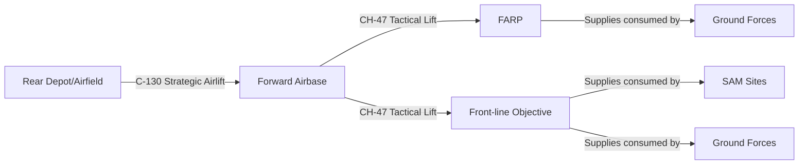

# Logistics Gameplay Loop -- CH-47 Chinook and C-130 Hercules

## Design Philosophy

The current campaign has a gap: resources are generated locally at structures and consumed locally for ground unit spawning. There is no concept of a **supply chain** connecting rear-area production to front-line consumption. This means transport aircraft have no role.

The logistics loop introduces a **supply economy** where front-line objectives consume supplies to remain combat-effective, and rear-area depots produce those supplies. Transport aircraft (C-130 for strategic airlift, CH-47 for tactical lift) bridge the gap. The player can fly these missions or let the AI handle them.

---

## Core Concept: Supply Flow



**Three tiers of supply nodes:**

1. **Rear Airfields** -- safe, high-capacity, produce supplies passively (existing Depot/Barrack resource generation)
2. **Forward Airfields** -- moderate capacity, act as staging hubs, need resupply from rear
3. **FARPs / Front-line Objectives** -- low capacity, need frequent tactical resupply via helicopter

---

## Design Decisions

- **Single unified supply type**: One "Supply" resource covers fuel, ammo, food, and equipment. This keeps the system simple to understand and balance while still creating meaningful logistics decisions (which node to resupply first, risk vs. reward of contested routes). The strategic depth comes from route planning and prioritization, not resource type juggling.
- **Internal cargo in DCS**: Player-flown transport missions use DCS internal cargo objects. The cargo is loaded at the source airfield and unloaded on landing at the destination via Lua triggers. No sling load complexity.

---

## New Data Model: Supply Levels

Each objective and airdrome gains a `supply` property:

- **supply.current** -- current supply points (0..max)
- **supply.max** -- storage capacity (varies by node type: airfield=10000, FARP=2000, objective=1000)
- **supply.consumptionRate** -- how fast supplies drain (proportional to hosted units/SAMs)
- **supply.productionRate** -- how fast supplies are locally produced (only at rear depots, from existing resource system)
- **supply.status** -- 'abundant' | 'adequate' | 'low' | 'critical' | 'depleted'

**Impact of supply level on combat effectiveness:**

- **Abundant (>75%)**: Full effectiveness, ground units spawn normally, SAMs fully operational
- **Adequate (50-75%)**: Normal operations
- **Low (25-50%)**: Ground unit spawn rate halved, SAM engagement range reduced 25%
- **Critical (5-25%)**: No new ground unit spawns, SAM engagement range reduced 50%, aircraft sortie rate halved
- **Depleted (0-5%)**: SAMs go offline, ground units cannot fight, airfield cannot generate sorties

This makes logistics **strategically meaningful** -- a front-line collapse can happen not from bombing but from supply starvation.

---

## Transport Mission Types

### 1. Strategic Airlift (C-130)

- **Route**: Rear airfield --> Forward airfield
- **Cargo capacity**: 5000 supply points per sortie
- **Flight profile**: High altitude (6000m), fast cruise (340kts), uses runways
- **Risk**: Vulnerable to CAP intercept, flies at altitude through contested airspace
- **Escort option**: Can be paired with fighter escort package (new package type: "Airlift Package")
- **DCS integration**: C-130 spawns with cargo, lands at destination, unloads (scripted via triggers), returns to base

### 2. Tactical Lift (CH-47)

- **Route**: Forward airfield --> FARP or front-line objective
- **Cargo capacity**: 1500 supply points per sortie
- **Flight profile**: Low altitude (150m), slow cruise (90kts), can land at FARPs/helipads
- **Risk**: Vulnerable to SHORAD, small arms, enemy CAS; flies low through contested airspace
- **Escort option**: Can request attack helicopter or CAS escort
- **DCS integration**: CH-47 spawns with internal cargo, lands at FARP/LZ, cargo unloaded via Lua trigger, returns

### 3. Emergency Resupply (CH-47 -- priority variant)

- **Triggered when**: A node reaches "Critical" supply status
- **Behavior**: Bypasses normal queue, immediate dispatch
- **Smaller load**: 750 supply points (fast turnaround, partial load)
- **Higher priority for player notification**: "Emergency resupply requested at Objective Alpha"

---

## How It Fits the Existing Architecture

### Spawn System Integration

A new spawn module: `apps/campaign/src/logic/systems/spawn/packages/transport.ts`

```
spawnTransportMissions(draft, coalition):
  1. Calculate supply deficit at each node (max - current)
  2. Sort nodes by urgency (lowest supply% first)
  3. For each deficit node:
     a. Find nearest supply source with surplus
     b. If source is airfield and dest is airfield: spawn C-130 mission
     c. If dest is FARP or objective: spawn CH-47 mission
     d. Respect maxActive limits (config: Transport.maxActive)
  4. Create TransportFlightGroup with cargo manifest
```

### New Entity: `TransportFlightGroup`

Extends `FlightGroup` with:

- `cargoAmount`: supply points being carried
- `sourceNode`: origin objective/airdrome ID
- `destinationNode`: destination objective/airdrome/FARP ID
- `cargoStatus`: 'loaded' | 'in-transit' | 'delivered' | 'lost'

Key behavior:

- On takeoff: deduct `cargoAmount` from source node supply
- On landing at destination: add `cargoAmount` to destination node supply
- On destruction: cargo is lost (supply deducted from source but never arrives)

### New System: `update-supply.ts`

Runs every logic tick (1s):

- Drain supply at each node based on `consumptionRate`
- Rear depots produce supply passively (replaces/augments current resource system)
- Update supply status thresholds
- Apply combat effectiveness modifiers based on supply status

### Config Addition in `packages/contracts/src/config.ts`

```typescript
Transport: {
  maxActive: { player: 3, opponent: 3 },
  maxDistance: 400_000, // 400km strategic range
  tacticalMaxDistance: 80_000, // 80km for CH-47
  c130CargoCapacity: 5000,
  ch47CargoCapacity: 1500,
  emergencyCargoCapacity: 750,
  aircraftsPerGroup: 1
}
```

### Faction Updates

In `packages/data/src/factions/usa-2004.ts`, populate the Transport slot:

```typescript
Transport: ['C-130', 'CH-47D']
```

---

## DCS Integration Flow

Transport missions interact with DCS in two distinct ways depending on whether the AI or the player is flying:

### AI Transport (Campaign Simulation Only)

AI transport flights are simulated entirely inside the campaign tick loop. No special DCS scripting is needed beyond what already exists:

1. `TransportFlightGroup` is created with waypoints (takeoff -> cruise -> land at destination -> RTB)
2. Each fast tick, `FlightGroup.move()` interpolates position along waypoints (existing logic)
3. Enemy `CapFlightGroup.engageAirTargets()` can intercept transport flights (existing A2A logic -- transport aircraft have no weapons, so combat is one-sided)
4. When `isLanded()` returns true at the destination, `cargoAmount` is credited to the destination node's `supply.current`
5. The transport aircraft **also appears as an AI unit in the generated .miz**, so the player sees C-130s and CH-47s flying around during their own combat missions. This uses the existing `add-flight-groups.ts` logic in `packages/generate-miz/`.

### Player-Flown Transport (DCS Mission Required)

When the player claims a transport mission, the .miz generator creates a flyable mission:

1. **Aircraft placement**: Player spawns at the source airfield in the CH-47 or C-130 (cold start or hot start). Uses existing flight group placement in `packages/generate-miz/src/add-flight-groups.ts`.
2. **Cargo setup**: A DCS cargo object (e.g., `'ammo_cargo'`, `'uh1h_cargo'`, or generic `'Cargo1'`) is spawned at the player's aircraft position with a `SetInternalCargo` command. MIST already supports cargo objects (`canCargo` flags in `mist_4_5_126.lua`).
3. **Waypoints**: Pre-planned route from source to destination LZ, matching the campaign's flight plan. Player can deviate but the destination trigger zone stays fixed.
4. **Destination trigger zone**: A trigger zone at the FARP/LZ/airfield destination. When the player's unit enters the zone and speed drops below threshold (landed), a Lua trigger fires:
   - Sets flag: `TRANSPORT_DELIVERED_<missionId> = true`
   - Removes the cargo object
   - Optionally plays a radio message: "Cargo offloaded, RTB when ready"
5. **State export**: The existing `state.lua` script is extended to write the transport delivery flag to the mission state file.
6. **State import**: `loadMissionState()` in `apps/core/src/main/api/campaign/index.ts` reads the flag and credits supplies to the destination node. If the flag is absent (player crashed, never landed, or was shot down), cargo is marked as lost.

### Key Point: No New DCS APIs Required

Everything uses existing DCS trigger/scripting capabilities:

- Trigger zones (standard DCS feature)
- `SetInternalCargo` action (DCS scripting command)
- Flag-based state tracking (existing `state.lua` pattern)
- MIST cargo support (already bundled in the project)

---

## Player Interaction Design

### Option A: Fully Automated (Default)

The AI handles all logistics. Transport missions appear on the map as blue helicopter/cargo plane icons moving between nodes. The player sees the supply chain operating and can focus on combat missions. Supply status indicators on objectives show the health of the logistics network.

### Option B: Player-Flown Logistics

When a transport mission spawns, the player can "claim" it (like existing takeoff mechanic):

- The mission generates a .miz with the player in the CH-47 or C-130
- Waypoints are pre-planned: takeoff --> route --> landing zone --> unload --> RTB
- Cargo is represented via DCS internal cargo system
- Successful delivery credits the destination node
- If the player crashes or is shot down, the cargo is lost

**Player incentives:**

- XP/score multiplier for front-line deliveries under fire
- "Lifeline" bonus when delivering to a Critical node
- Optional secondary tasks during transport (e.g., CSAR pickup on return leg, paradrop troops)

### Option C: Mixed Mode

Player flies high-value emergency resupply missions; AI handles routine logistics. A toggle in campaign settings: `logisticsMode: 'automated' | 'player' | 'mixed'`

---

## Supply Consumption Model

What drains supply at a node:

| Consumer                | Drain Rate (per tick) | Notes                                |
| ----------------------- | --------------------- | ------------------------------------ |
| Ground group (per unit) | 2                     | Infantry and vehicles need ammo/fuel |
| SAM site (active)       | 5                     | Missiles and radar power             |
| Aircraft sortie         | 50 (one-time)         | Fuel and munitions per takeoff       |
| Structure repair        | 100 (one-time)        | Rebuilding destroyed buildings       |

What produces supply:

| Source               | Production Rate            | Notes                             |
| -------------------- | -------------------------- | --------------------------------- |
| Rear Depot structure | 20/tick per alive building | Existing resource gen, repurposed |
| Ammo Depot bonus     | +10/tick                   | Existing bonus structure          |
| Fuel Storage bonus   | +10/tick                   | Existing bonus structure          |
| Captured enemy depot | 50% rate for 1 hour        | Windfall from capture             |

---

## Enemy Logistics (Opponent AI)

The opponent coalition runs the same logistics system. This creates a new **strategic target class**: transport aircraft and supply routes.

- Player CAP missions near enemy supply routes can intercept C-130s
- Player strike missions can target enemy Depots to cripple supply production
- Destroying enemy FARPs cuts off forward supply
- This adds a new victory condition angle: **logistical strangulation**

---

## Campaign Map UI Additions

On the existing MapLibre map in `apps/campaign/src/routes/active/home/home.tsx`:

1. **Supply indicators**: Colored ring around each objective showing supply level (green/yellow/orange/red)
2. **Supply routes**: Dashed lines showing active transport routes
3. **Transport aircraft icons**: Distinct icons for C-130 (cargo plane) and CH-47 (dual-rotor helo)
4. **Supply panel**: Sidebar showing supply status of all nodes, sortable by urgency
5. **"Request Resupply" button**: Player can manually prioritize a node for resupply

---

## Implementation Phases

### Phase 1: Supply Economy Foundation

- Add `supply` fields to objective/airdrome schemas
- Implement `update-supply.ts` system (consumption + production)
- Add supply status effects on combat (SAM degradation, spawn rate reduction)
- Wire into existing `logicTick`

### Phase 2: AI Transport Missions

- Create `TransportFlightGroup` entity
- Create `transport.ts` spawn module
- Add transport route planning (source/destination selection)
- Add C-130 and CH-47 to faction Transport slots
- Generate transport flights in .miz output

### Phase 3: Player Integration

- Add logistics mode setting ('automated' | 'player' | 'mixed')
- Enable "claim mission" UI for transport flights
- Generate player-flyable .miz with cargo setup
- DCS scripting for cargo load/unload triggers
- Supply delivery confirmation from mission state import

### Phase 4: Strategic Depth

- Enemy logistics targeting (intercept transport, strike depots)
- Escort packages for high-value transports
- FARP establishment missions (CH-47 builds new FARP)
- Airdrop capability for C-130 (paradrop supplies to objectives without airstrip)
- Supply convoy ground routes as fallback when air transport is suppressed
